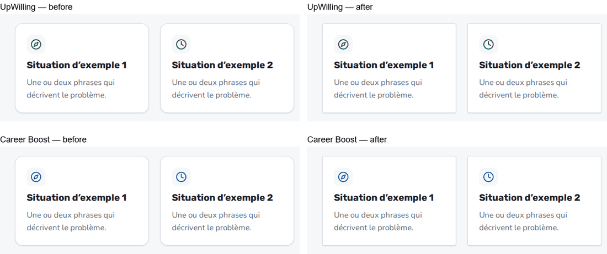
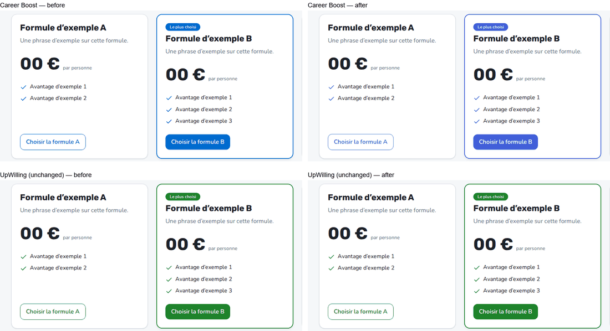

# Essai 2 — Design system and section patterns

- Phase 0, Essai 2 (without VLAB, ADR-015). Roadmap milestone M2. Skeleton written 2026-11-25 (Task 2.5c); proof
  and report written 2026-11-25 (Task 2.6, PR #38). The PO design review fills the feedback below.
- **Result: conclusive for the three technical criteria; the PO design review is still to do.** One base value
  changes both sites, Career Boost's blue changes Career Boost only, and the visual tests catch both. Proving it found
  a gap: the screenshot comparison was too tolerant to see a brand-color change. It was fixed in the same task.

## Exit criteria (05_ROADMAP.md, M2)

| Criterion | Status | Evidence |
|---|---|---|
| Changing one base value changes both sites | **Proven** | Proof A: 44 of 187 screenshots changed in each brand |
| Career Boost's blue and logo stay specific | **Proven** | Proof B: 101 of 187 Career Boost screenshots changed, 0 of 187 UpWilling; logos per brand on `/dev/demo` |
| Visual regression detects both cases | **Proven, after a fix** | The CI `visual` job failed on both proofs once its color tolerance was tightened (below) |
| PO design review done | To do | Section "PO design review" below |

## What exists (Tasks 2.1 to 2.5)

- Tokens: one source for color, spacing and type; a theme per brand; contrast tested for every text/background pair
  in both brands (Task 2.1). Fonts Rubik and Nunito, self-hosted (Task 2.4a).
- Components: primitives, forms, accordion, tabs, dialog, breadcrumbs (Task 2.2); header, footer and page layout
  (Task 2.4b); 15 section patterns from 04_DESIGN_SYSTEM.md §4 (Task 2.5).
- Storybook with a brand switcher and an accessibility panel; a screenshot of every story in both brands, compared on
  every pull request (Task 2.3).
- How-to: `packages/design-system/README.md`. Technologies and versions: `docs/tech-stack.md`.

## PO design review

**Where:** recette (password-protected), one demo home page per brand, all copy synthetic:

- Academy: `https://upwilling-recette.tail3810a7.ts.net/dev/demo`
- Association: `https://careerboost-recette.tail3810a7.ts.net/dev/demo`
- Also: `/dev/tokens` (the two color themes) and `/dev/components` (the building blocks) on both addresses; Storybook
  on the supervisor's laptop.

**How:** the reference site (`https://www.massar-academy.com/en`) side by side, for structure and rhythm only: nothing
is copied from it (04_DESIGN_SYSTEM.md §1). Look at each page on a phone and on a computer.

**Date and participants:** _to fill in_

### Feedback

One row per remark. "Decision" is what the PO chose; "Follow-up" is the task that carries it out.

| # | Page / section | Remark (PO's words) | Decision | Follow-up |
|---|---|---|---|---|
| 1 | | | | |

### Decisions to take during the review

| Topic | Today (provisional) | PO decision |
|---|---|---|
| Brand colors (TR-01b) | Adjusted for readable contrast: academy green `#2E7D34` → `#1E832B`, association blue `#0070D8` → `#006BCF`, body text `#16233A` → `#1C2128`, secondary text `#4B5563` → `#636E7F` | |
| Fonts | Rubik (titles), Nunito (text), Task 2.4a | |
| Logo files | Career Boost: raster logo from the holding page; academy: mark + name | SVG files, light and dark |
| Legal details in each footer | `[À compléter par le PO]` placeholder (Task 2.4b) | Name, legal form, address, SIRET; academy: training declaration number |
| Section order of each home page | 04_DESIGN_SYSTEM.md §5, as on `/dev/demo` | |

## Propagation proof (Task 2.6)

Each proof was a throwaway branch with a draft pull request, never merged (PRs #36 and #37, closed, branches
deleted). The `visual` job screenshots every Storybook story in both brands (187 per brand) and compares them with the
committed baselines.

| Proof | Change | Visual job, tolerance 0.2 (before) | Visual job, tolerance 0.05 (after the fix) |
|---|---|---|---|
| A — one base value | `radius.lg` 1rem → 0.25rem in `tokens/base/shape.json` (shared by both brands; one line of `css/tokens.css`) | Failed: 13 screenshots per brand changed (run 45651248873) | Failed: **44 per brand**, the same stories in both (run 45653580215) |
| B — Career Boost's blue | Source color `blue` #0070D8 → #3550C8 in `tokens/base/color.json` (only Career Boost's primary palette uses it; every changed CSS line is inside `[data-brand="careerboost"]`) | **Passed: the change went unseen** (run 45651318611) | Failed: **101 Career Boost, 0 UpWilling** (run 45653234260) |

**The gap and its fix.** Playwright compares pixels with a color tolerance (`threshold`, 0 to 1). We had kept its
default, 0.2, chosen to absorb anti-aliasing. Career Boost's primary moved by 0.136 on that scale (hover 0.101, focus
ring 0.099): under the tolerance, so proof B passed, and in proof A the pale card borders hid the new corners in most
stories. The tolerance is now **0.05** (`packages/design-system/playwright.config.ts`). The screenshots are always taken
in the same pinned container, so the stricter value causes no false failures: CI on develop's code passed with it
(run 45653267108, PR #38) before any proof ran with it.

**Logo.** Logos are images per brand, not tokens: a token change cannot affect them. Each site's own logo shows in the
header of `/dev/demo` (academy: mark and name; Career Boost: its logo).

## Conclusion

- **Technical part: conclusive.** The design system propagates as intended: shared values reach both sites, brand
  values stay in their brand, and CI catches both kinds of change before a merge.
- **To close M2:** the PO design review on recette (feedback and decisions above), then the supervisor's decision.
  Feedback that changes components or tokens becomes its own tasks; brand decisions (colors, fonts, logos) update the
  tokens and the visual baselines in the same pull request.
- **Limits:** the screenshots cover Storybook stories, not the app's pages (the app's pages have end-to-end and
  accessibility tests, not screenshots). A color change smaller than the new tolerance (0.05) would still pass;
  brand colors are decided by the PO, so such a change would be deliberate.
